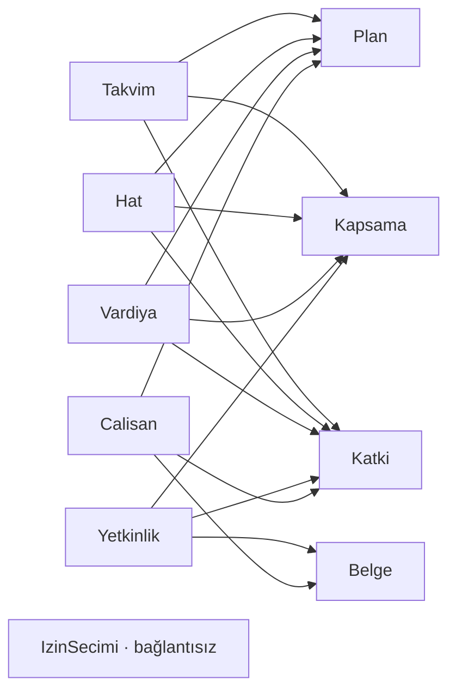

# Vardiya ve Yetkinlik Açığı

**5.000 çalışan üzerinden vardiya riski ve izin etkisi analizi · Power BI**

Otomotiv yan sanayinde personel sayısı yeterli olsa bile belirli bir işi yapmaya yetkili tek çalışan izne çıktığında üretim hattı açık verebilir. Bu proje, vardiya planını çalışan yetkileri ve hat ihtiyaçlarıyla eşleştirerek hangi göreve destek gerektiğini gösterir.

Tüm operasyonel kayıtlar sentetiktir. Profil fotoğrafı ve iletişim bilgileri proje sahibine aittir.

## İş soruları

- Hangi tesis, hat ve vardiyada yetkin kişi sayısı ihtiyacın altında?
- Hangi işler tam asgari kişi sayısıyla yürütülüyor?
- Seçilen çalışan izne çıkarsa nerede yeni açık oluşuyor?
- Hangi görev son yedeğini kaybediyor?
- Aynı tesis ve vardiyada başka bir hattan kim destek verebilir?

## Rapor sayfaları

| Sayfa | Analiz ve etkileşim |
|---|---|
| **Vardiya dengesi** | İhtiyaç, açık, tam sınırdaki görev ve karşılama oranı kartları. Yetkinlik ve vardiya karşılaştırmaları, günlük risk eğilimi. |
| **İzin simülasyonu** | Çalışan seçimiyle yeni açık ve yedek kaybı hesabı. Etkilenen görevler için destek adayı tablosu. |

Tesis, hafta, vardiya, üretim alanı ve yetkinlik filtreleri analizi daraltır. Başlıklar seçilen tesis veya çalışana göre değişir. Sol paneldeki düğmeler sayfalar arasında geçiş sağlar. Mavi tonları, beyaz analiz kartları ve yuvarlatılmış panel geçişi ortak görsel dili oluşturur.

## Veri kapsamı

| Kapsam | Değer |
|---|---|
| Çalışan | 5.000 |
| Tesis | Bursa, Kocaeli, Sakarya, Eskişehir |
| Üretim hattı | 48 |
| Üretim alanı | Pres, kaynak, işleme, montaj |
| Yetkinlik | 10 |
| Vardiya | Sabah 06–14, akşam 14–22, gece 22–06 |
| Plan dönemi | 2–29 Kasım 2026 |
| İhtiyaç satırı | 16.128 |

Her ihtiyaç satırı **gün × hat × vardiya × yetkinlik** düzeyindedir. Yetkin çalışan bulunmayan ihtiyaçlar da açık hesabına girer.

## Yıldız şema

Model, ortak boyutları paylaşan dört olgu tablosundan oluşur. Bire çok ilişkilerde filtre boyuttan olguya tek yönde ilerler. Tesis ve üretim alanı Hat boyutunda tutulur.

| Tablo | Tür | Bir satırın anlamı |
|---|---|---|
| Takvim | Boyut | Plan gününün tarihi ve haftası |
| Hat | Boyut | Tesis ve üretim alanıyla birlikte bir hat |
| Vardiya | Boyut | Bir vardiya dilimi |
| Yetkinlik | Boyut | Takip edilen bir iş yetkisi |
| Calisan | Boyut | Bir sentetik çalışan |
| Plan | Olgu | Çalışanın bir gün, hat ve vardiyadaki görevlendirmesi |
| Belge | Olgu | Çalışanın bir yetkinlik için geçerlilik dönemi |
| Kapsama | Olgu | İhtiyaç, mevcut kişi sayısı ve destek adayı |
| Katki | Olgu | Çalışanın bir ihtiyaca geçerli katkısı ve ayrılmasının eşik etkisi |
| IzinSecimi | Bağlantısız seçim | İzin senaryosunda incelenecek çalışan |



Üretici, görevlendirme ve yetki geçerliliğini birleştirerek Kapsama ve Katki tablolarını hazırlar. DAX ölçüleri bu tabloları filtre bağlamında hesaplar. IzinSecimi tablosundaki seçim, TREATAS ile yalnızca senaryo hesabına uygulanır. Mevcut vardiyanın tüm çalışanları temel hesapta yer alır.

## Ölçüler

| Ölçü | İş anlamı |
|---|---|
| İhtiyaç satırı | Seçili bağlamdaki ihtiyaçların sayısı |
| Mevcut açık | Yetkin kişi sayısı asgari ihtiyacın altında kalan ihtiyaç sayısı |
| Tam sınırda | Yetkin kişi sayısı asgari ihtiyaca eşit olan ihtiyaç sayısı |
| Yedekli | Asgari ihtiyacın üzerinde yetkin kişisi bulunan ihtiyaç sayısı |
| Karşılama oranı | Karşılanan ihtiyaçların toplam ihtiyaçlara oranı |
| Yeni açık | Çalışan ayrılınca ilk kez asgari sayının altına düşen ihtiyaç sayısı |
| Yedeğini kaybeden | Çalışan ayrılınca asgari sayının bir üzerinden tam sınıra düşen ihtiyaç sayısı |
| İzin sonrası açık | Mevcut açık ile yeni açığın toplamı |

Sayım birimi vardiya-yetkinlik ihtiyacıdır. Aynı çalışan birden fazla yetkinliğe katkıda bulunabilir. Başlangıçta açık olan bir görevde eksiklik büyürse görev mevcut açık içinde sayılmaya devam eder.

```dax
Yeni açık =
VAR Kisi = SELECTEDVALUE(IzinSecimi[KisiID])
RETURN
    IF(
        NOT ISBLANK(Kisi),
        COALESCE(
            CALCULATE(
                SUM(Katki[Kritik]),
                TREATAS({Kisi}, Katki[KisiID])
            ),
            0
        )
    )
```

Katki[Kritik], çalışanın katkı verdiği ihtiyaçta mevcut kişi sayısı asgari sayıya eşit olduğunda 1 değerini alır. Çalışan seçilmediğinde senaryo ölçüleri boş döner.

## Örnek senaryo

1. **İzin simülasyonu** sayfasını açın.
2. **Çalışan 4225** seçin.
3. Tesis olarak **Bursa**, hafta olarak **Hafta 1**, vardiya olarak **06–14 Sabah** seçin.
4. Yetkinliği **Hat serbest bırakma** olarak daraltın.
5. Detay tablosunda **2 Kasım 2026 · Bursa · Pres 01** satırını inceleyin.

Bu görevde yetkin kişi sayısı izinle **1'den 0'a** düşer. Başka bir hatta görevli **Çalışan 0388**, kaynak hattında yeni açık oluşturmayan destek adayıdır.

## Başlangıç planındaki bulgular

Tüm dönem ve tesisler seçiliyken elde edilen sentetik sonuçlar aşağıdadır.

| Gösterge | Sabah | Akşam | Gece |
|---|---:|---:|---:|
| İhtiyaç satırı | 5.376 | 5.376 | 5.376 |
| Mevcut açık | 438 | 429 | 334 |
| Tam sınırda | 912 | 924 | 773 |

Toplam **1.201 açık**, **2.609 tam sınırdaki ihtiyaç** ve **%92,6 karşılama oranı** bulunur. Vardiyalar arasındaki fark ekip yetkileri ile üretim programındaki asgari kişi gereksinimlerinden doğar.

## Varsayımlar ve kapsam

- Dört ekip dönüşümlü çalışır. Her gün üç ekip görev alır, bir ekip dinlenir.
- Belge tablosu özel iş yetkilerini kapsar. Her çalışan bu yetkilere sahip olmayabilir.
- Gece vardiyasında yetki geçerliliği ertesi günü de kapsamalıdır.
- Hafta içi sabah pres kalıp değişimi ve akşam CNC takım ayarı için iki yetkili gerekir. Ölçüm onayı için sabah ve akşam iki, düşük hacimli gece programında bir yetkili aranır. Bunlar demo üretim programının varsayımlarıdır.
- İzin seçimi, seçili dönem boyunca çalışanın planlanmış görevlerine uygulanır.
- Aynı kişinin birden fazla yetkinliği karşılaması, işlerin vardiya içinde farklı zamanlarda yapılabildiği varsayımına dayanır.
- Destek adayı aynı tesis ve vardiyada başka bir hatta bulunmalıdır. Adayın ayrılması, kaynak hattında karşıladığı herhangi bir yetkinliği asgari sayının altına düşürmemelidir.
- Destek önerisi her ihtiyaç için bağımsız hesaplanır. Bir adayın birden fazla göreve aynı anda atanmasını engelleyen toplu transfer optimizasyonu kapsam dışındadır.

## Projeyi açma

1. Proje klasörünü alt klasörleriyle birlikte indirin.
2. Power BI proje dosyalarını destekleyen Power BI Desktop ile **Vardiya.pbip** dosyasını açın.
3. **Yenile** komutunu çalıştırın.

Veriler Power Query bölümlerine sıkıştırılmış olarak gömülüdür. Veri kaynağı için dosya yolu ayarlamak gerekmez. Aynı kayıtların CSV kopyaları veri klasöründedir. CSV değişiklikleri gömülü kaynağa otomatik yansımaz.

